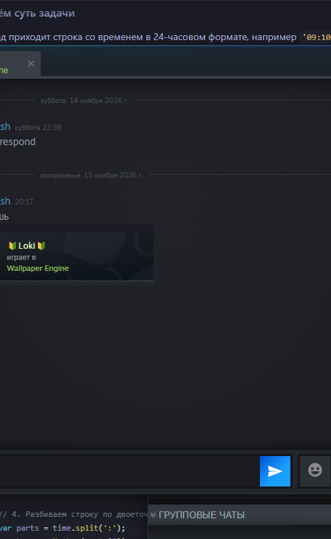
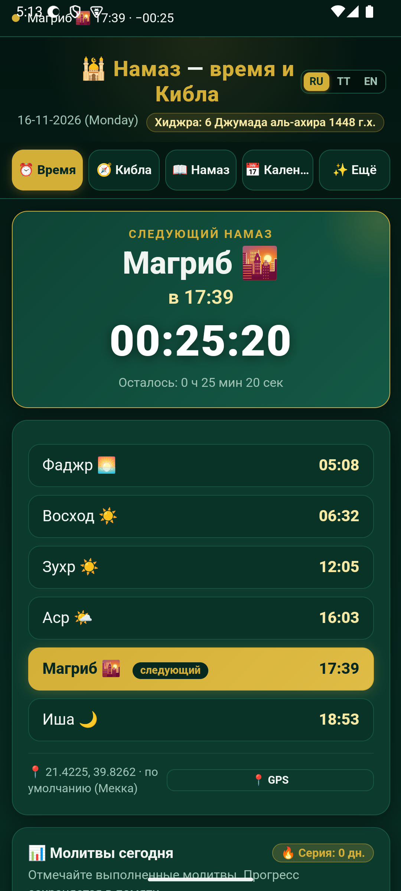
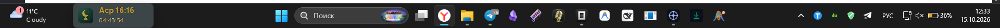
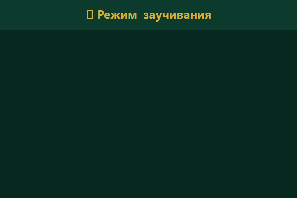

# namaz-vakit — Намаз PWA + Windows виджет

[](https://github.com/remageht/namaz-vakit/actions/workflows/validate.yml)

PWA-приложение + виджет Windows: время намаза, обратный отсчёт, уведомления, компас Киблы, уроки 5 намазов, **99 имён Аллаха** с режимом заучивания и офлайн-расчётом.

## Скриншоты

| Заставка (Desktop) | Заставка (Android) |
|---|---|
|  |  |

| Приложение (Windows) | Приложение (Android) | Виджет в трее | Квиз |
|---|---|---|---|
|  |  |  |  |

## Заставка / Splash

Кинематографичный экран появления во всех средах: изумрудный фон, золотые лучи и частицы,
полумесяц в восьмиконечной звезде (rub el hizb), shimmer-заголовок и **аят дня золотой
арабской каллиграфией** с переводом RU/TT/EN и ссылкой на суру.

- **PWA / WebView** — HTML-splash внутри `index.html` (0 мс офлайн-расчёт идёт под splash).
- **Windows / Linux / macOS (Electron)** — отдельное нативное splash-окно (`desktop/splash.html`)
  с плавной передачей основному окну.
- **Android** — системный `SplashScreen` (API 31+, `windowSplashScreenAnimatedIcon`) и
  брендовый `windowBackground` для Android 8–11.
- Пропуск по тапу/Escape, поддержка `prefers-reduced-motion`, самоочистка из DOM.

## Сборка Android

```bash
cd android
# Требуется Android SDK (compileSdk 35, minSdk 26) и JDK 17+ (например, JBR из Android Studio)
JAVA_HOME="<path-to-jdk-17+>" gradle :app:assembleDebug
# APK: android/app/build/outputs/apk/debug/app-debug.apk
```

Синхронизация ассетов PWA в обёртки перед сборкой: `node desktop/sync-assets.js`.

## Возможности

- ⏰ **Время намаза** через Aladhan API + авто-GPS + ручной ввод lat/lon, выбор метода (2=MWL, 14=РФ, 3=Egypt) и мазхаба (Ханафи/Шафии)
- ⏳ **Обратный отсчёт** ЧЧ:ММ:СС до следующего намаза, подсветка в списке
- 🔔 **Уведомления**: за 10 мин — «Подготовка к молитве», в 00:00 — «Время намаза», дедупликация localStorage, тест-кнопки, звук AudioContext
- 🧭 **Компас Киблы**: азимут + дистанция до Каабы (21.422487, 39.826206), круглый компас N/S/E/W, DeviceOrientation + fallback слайдер 0-360°, вывод qibla°/heading°/delta°/км + «✅ На Кибле», если delta<8°
- 📖 **Уроки**: Вуду по шагам, Фаджр 2, Зухр 4, Аср 4, Магриб 3, Иша 4 + тексты: Фатиха, Ихлас, Ташаххуд, Салават + speak() ar-SA
- ☝️ **99 имён Аллаха**: имя дня (1 имя/сутки по циклу), зикр 99 раз с прогресс-баром, режим заучивания (арабский → 4 варианта перевода, счёт сессии)
- 🌙 **Утреннее уведомление**: BalloonTip с именем дня при первом запуске виджета
- 📴 **Офлайн-расчёт**: при недоступности API виджет считает время методом Egypt (Fajr 19.5°, Isha 17.5°), Ханафи, погрешность ≤2 мин
- 📦 **PWA**: manifest.json, Service Worker cache-first, иконки 192/512 (полумесяц), установка: Android → ⋮ → Установить, iPhone → Поделиться → На экран Домой
- ✨ **Заставка**: нативный splash в PWA / Electron / Android с золотой каллиграфией аята дня, пропускается, уважает reduced-motion

## Установка

### Windows — виджет в трее (автозапуск)

1. **Один клик** — запуск скрипта установки:
   ```bash
   Install.bat
   ```
   Или вручную:
   - Разместите `C:\dev\namaz-app\NamazWidget.ps1` и `Start-NamazWidget.vbs` на компьютере
   - `Start-NamazWidget.vbs` создаст ярлык в меню «Автозагрузка» Windows и на рабочий стол
   - При каждом включении ноутбука виджет появится рядом с часами на панели задач
   - Плашка фиксирована: перетаскивание отключено, она сама возвращается рядом с погодой каждые 250 мс
   - Двойной клик — открыть полное приложение в браузере
   - Правый клик → «Скрыть панель» / «Показать панель»

2. **Удаление**:
   ```bash
   Uninstall.bat
   ```
   Удалит ярлыки из автозагрузки и с рабочего стола, завершит процессы.

### На телефон (PWA — без Play Market)

- **Android Chrome**: открой `https://remageht.github.io/namaz-vakit/` → меню ⋮ → **Установить приложение**
- **iPhone Safari**: открой ссылку → Поделиться → **На экран «Домой»**

### Локальный запуск (для разработки)

Для тестирования локально необходим HTTP-сервер (Service Worker не работает при `file:///`):

```bash
# Вариант 1: через npx serve
npx serve C:\dev\namaz-app

# Вариант 2: через Python
python -m http.server 8000

# Откройте в браузере:
http://localhost:8000
```

### Настройка координат и метода

По умолчанию заданы нейтральные координаты (Мекка): lat=21.4225, lon=39.8262, метод=3, школа=1 (Ханафи). Реальное место определяется через GPS, выбор города или ручной ввод.
Чтобы сменить место — отредактируйте `config.json`:
```json
{
  "latitude": 55.75,
  "longitude": 37.61,
  "method": 2,
  "school": 1,
  "place": "Москва"
}
```

> **Важно**: ключи `config.json` не переименовывать — они используются как виджетом, так и приложением.

## Развертывание на GitHub Pages

1. Залить файлы в репозиторий
2. Settings → Pages → Deploy from branch → `main` → `/ (root)` → Save
3. Сайт доступен по ссылке: `https://remageht.github.io/namaz-vakit/`
4. Откройте её на телефоне — баннер установки появится автоматически (нужен HTTPS, который GitHub Pages дает бесплатно)

## Структура репозитория

| Файл | Описание |
|------|----------|
| `index.html` | Главная страница: табы Время / Кибла / Намаз / Имена / Настройки, вся логика |
| `manifest.json` | Конфигурация PWA: name/short_name Намаз, standalone, `#06281f`, иконки 192/512 |
| `sw.js` | Service Worker: Cache-First, кэш `namaz-v1`, `skipWaiting()`, `clients.claim()` |
| `icon-192.png` | Иконка 192×192 px (золотой полумесяц) |
| `icon-512.png` | Иконка 512×512 px |
| `NamazWidget.ps1` | Виджет Windows (трей + мини-панель + офлайн-расчёт + 99 имён) |
| `Start-NamazWidget.vbs` | VBS-скрипт для автозапуска в меню «Автозагрузка» |
| `Install.bat` | Быстрая установка виджета в автозагрузку + desktop shortcut |
| `Uninstall.bat` | Полное удаление ярлыков и процессов |
| `config.json` | Координаты/метод/школа (Мекка по умолчанию) |
| `screenshots/` | Скриншоты виджета и PWA |
| `.gitignore` | Игнорирует `.agent/`, `widget.log`, `names_start.txt` и `node_modules/` |

## CI

GitHub Actions (`.github/workflows/validate.yml`) при каждом push:
- ✅ Проверяет синтаксис `NamazWidget.ps1` через PSParser
- ✅ Проверяет `manifest.json` (name, short_name, display)
- ✅ Проверяет наличие всех обязательных файлов

## Публикация

```bash
git add index.html manifest.json sw.js icon-*.png README.md .gitignore NamazWidget.ps1 screenshots/ .github/
git commit -m "feat: описание изменений"
git push origin main
```

## Лицензия

MIT License — бесплатное использование, модификация и распространение.